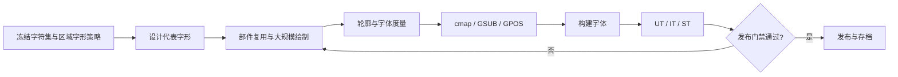

# FONT-HKP-DD-001｜字体工程详细设计

- 对应需求：REQ-006、007、008、012
- 状态：可实施规划；真实字形源文件与构建尚未创建

## 1. 交付链路



## 2. 源文件与目录

```text
font-src/
├── masters/            # 源字形 / UFO 等项目文件
├── features/           # OpenType 特性源文件
├── data/               # Unicode 清单与地区变体
├── scripts/            # 构建与校验脚本
├── tests/              # 字形、排版和平台测试
├── specimens/          # 单色及海报样张
└── dist/               # 构建后的发行物
```

推荐使用可版本管理的 UFO/Designspace 或等效字体设计工具源文件。`FontTools`、`FontMake`、`HarfBuzz`、`FontBakery` 可作为候选工具；实际工具链与版本锁定应在实施时记录，不假定所有工具适用。

## 3. 轮廓制作规范

- 采用封闭且方向一致的轮廓路径；需避免无意的自交、重叠和微小残留路径。
- 部件复用需明确来源、变换方式及人工光学校正；不要自动复用不适合挤压的复杂部件。
- 按“基准字—相同部件派生—整字修形—回归测试”制作，避免大规模机械缩放。
- 强化简繁变体或语言替换的显式管理，不把 `Unicode codepoint` 误当 `Glyph ID`。

## 4. OpenType 数据

| 类型 | 要求 |
|---|---|
| 必要头/度量/编码 | 按选用的 TrueType 或 CFF 字体轮廓及规范确定 `head`、`hhea`、`hmtx`、`maxp`、`cmap`、`name`、`OS/2`、`post` 等必需表 |
| 轮廓 | TTF：对应 `glyf`/`loca` 等；CFF/CFF2：根据选用技术实施，不能混用互斥轮廓假设 |
| GSUB | 只有实际需要本地化替换、连字或竖排替换时启用相应功能 |
| GPOS | Latin 字距、必要的 mark 定位及排版定位功能按需实施 |
| 可变字体 | 首期不做；后期单列 `fvar`、`STAT`、字形插值及相关表设计 |
| 网页字体 | `WOFF2` 从已验证的字体发行二进制构建，不视为可编辑源文件 |

## 5. 命名与版本

- 内部设计 ID：`GLY-0001` 之类，跨文档唯一；字形制作状态与字符覆盖表一致。
- 正式家族名称、版权、版本号以 `name` 等相关表所需字段写入；特别检查后续更新的名称兼容性。
- 发布示例：`HKPoster-Heavy.otf` 或 `.ttf`、`HKPoster-Heavy.woff2`；格式为目标，当前未实际生成。

## 6. 构建及证据

构建成功的必要证据：命令与版本、源提交版本、生成文件哈希、字体结构检查报告、样本字符串测试结果和平台载入验证。仅列出待实现命令不等于已运行。
